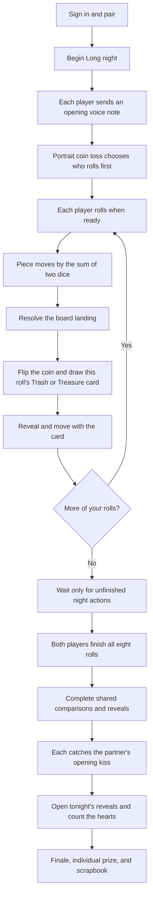

# At Long Last — Player Game Flow Manual

*Current-flow reference, checked against the game code and two-profile emulator playthrough on 2026-11-11.*

## What a night is

At Long Last is a two-player, shared-heart board night with an individual lap prize. The shared hearts belong to the couple’s night; they are not either player’s health. Each player moves their own piece, handles their own board landings, and can keep going without waiting for their partner. Shared comparisons gather until the end.

## Before the first roll

1. Sign in with Google or email. On the hosted site, a sign-in screen should appear. **Preview / Local play** is an offline fallback and does not sync between devices.
2. Invite your person by the email they use to sign in. They accept the invitation inside the game. Both accounts must be paired before beginning a shared night. The separate permanent **Commit** step is optional for play.
3. Before starting, both players choose a board look from **Our Story → Collection → Themes**. The night stays locked until their votes match; once they agree, that theme is saved for both boards. Choosing **Surprise us** is also a vote and must match. Existing couples with a saved shared theme keep that prior agreement.
4. From the paired lobby, choose **Begin our night**. The current button starts the Long night: eight rounds, or up to eight rolls per player. (Shorter presets remain in the code, but the current lobby starts the longest one.)
5. Each player records and sends a short voice note for the opening Kiss Courier. Recording pauses the music. Once a note is sent, tap **Begin our night** on that screen to close it and enter the board. Each player can do this independently; you do not have to wait for the other note before taking your first turn.

## The night, in order

## When and how the dice are rolled

- **You may roll when your own last landing is resolved.** Your partner’s unfinished turn does not block you. You can take your next roll after finishing your own activity or keepsake and resolving your moment card.
- **Either player may start.** The night has an internal starting-player value for prize tie-breaks, but it does not enforce alternating turns in this independent-paced flow.
- A portrait coin appears at the first board visit. Tap it once to reveal which portrait rolls first, then Continue. This is an opening presentation of the already-saved starting player; it does not block the other person's independent turns.
- There is no Vibe dial or tone ballot at night start. New nights go from the opening kiss to the board and first-turn coin.
- Tap or swipe directly on the dice. The camera rises to the dice, then pans back down toward the board as they tumble out of the tray. The gesture changes the visual throw and its strength; it does not choose the result. Keyboard Enter/Space also works on desktop.
- The app waits about **620 ms** before choosing two random six-sided values. The 3D dice then tumble for about **2 seconds**, and the piece hops one space at a time, with a short sound on each step.
- **The two dice are added together for the main move.** For example, a 2 and a 5 move the piece seven spaces. Double ones move two spaces; they do not cause another roll.
- Each player has one roll in each round, up to eight each in the current Long night. Round 3 does not mean “wait for round 2 to finish”: each person can be on a different round while moving at their own pace.

## What happens after a roll

Every roll creates two things: a landing on the 20-space board and one randomly drawn **Trash or Treasure moment**. The moment card is shown after the main piece movement.

### 1. Resolve the board landing

The landing is chosen by the destination space. Current effects are:

| Space | What it does |
| --- | --- |
| Heart | Adds 2 shared hearts. |
| Oops / snag | Removes 2 shared hearts. A Midnight Snack keepsake or unused tender momentum can cushion this. This is a change to the shared heart total, not player health. |
| Duel | Adds 1 shared heart to that round’s showdown reward. |
| Connection | Creates a mood-weighted activity or prompt for the player who landed. Complete your part and save it. |
| Mystery Card | Reveals a keepsake. Tap the card to collect it; collecting costs no hearts. Keepsakes may grant a one-use perk. |

Heart, Oops, and Duel effects apply from the main landing. Connection activities and keepsakes have a follow-up action. The roll’s moment card is a separate step and must also be resolved before you roll again.

### 2. Resolve the moment card

- Tap the coin when it is brought into view. The Trash or Treasure result is random and equally likely; the matching pile supplies a card from that category. The deck currently has 12 moments in each category.
- The **lower** die determines card movement: a value from 1 to 6 spaces. Treasure moves your piece forward that many spaces; Trash moves it backward.
- Tap **Move piece** to apply it. The card changes board/race progress; it does not add or remove hearts and does not trigger another board-space reward or a second card draw.
- The sum of the dice controls the main landing; the lower die controls only this separate card movement.

If your landing also created a Connection activity or a Mystery Card, finish that too. Then your next roll becomes available. Your partner may keep playing throughout.

## The shared comparisons

One shared mini-game is selected for each round when the first player rolls that round. It is not opened as a gate before the two personal turns. Once both players have taken all eight rolls, the shared mini-games appear for each player to submit their side. The final reveal waits until the board landings, moment cards, and both sides of every shared mini-game are resolved.

The current rotation contains these ten mini-games:

- **Wavelength:** answer five multiple-choice questions and guess your person’s answers; compare the choices at the end.
- **Kiss Courier:** play the short send-and-catch kiss animation. This is separate from the recorded voice notes sent at the start of the night.
- **Keepsake Sketch:** draw the selected prompt.
- **Portrait Panic:** send three drawing cues, then draw from the cues your person sent.
- **Letterpress:** add words to a shared sentence starter; the sentences are compared at the end.
- **Gratitude Duel:** each person responds to an appreciation prompt.
- **Star Map:** privately rank sentimental values, then compare rankings.
- **Quiet Moment:** choose a short breath, grounding, or muscle-release exercise.
- **Love in the Blanks:** choose words for a short story; each player's version is revealed later.
- **Our Next Line:** add eight words to a story or song seed; both versions are woven together at reveal.

Selection uses built-in activity weighting and avoids repeating a mini-game until it has used the available pool, then begins another pass. Players do not set a tone mix. Each player can submit their own response at their pace. A few sealed or paired interactions have a reveal step; the game makes those explicit. A partner may need to finish their response before that particular comparison can resolve, but other completed work stays saved. The former Vibe dial and Art Flash are not in the current flow; historical session records remain readable.

## The opening kiss and the final catch

These are the recorded voice notes, not the Kiss Courier mini-game animation:

1. At the beginning, each player records and sends one voice note (up to eight seconds).
2. After all rolls and comparisons are finished, each player opens **Catch their kiss** and catches the other player’s note.
3. The night can open its final reveals once both notes have been caught by the recipient.

## Finale, hearts, and the individual prize

After the required actions and catches are complete, tap **Open tonight’s reveals**. The game resolves the saved activities and comparisons, writes the scrapbook entries, and animates the shared-heart total into the finale.

The individual prize is based on board progress, not response speed or timestamps:

- First to complete a lap (20 cumulative spaces, including moment-card movement) earns the **First Lap Laurel**.
- If neither player completes a lap, the player furthest along earns the **Wayfinder Ribbon**.
- If both first cross in the same roll number, the night’s starting-player order breaks the tie.

The finale shows the shared hearts, keepsakes, saved moments, and individual prize. From there, open the Bound Scrapbook, share the keepsake capsule, or start another night.

## Optional trade

The Trade control can be used during the board night. Offer one keepsake you own for one of your person’s keepsakes. The exchange happens only if they accept; either player can dismiss a pending offer. Trading does not use a roll.

## Quick answers

**Do I wait for my person before rolling?** No. Resolve your own landing, then roll again. Shared comparisons wait until both players have finished their roll sets.

**What do the dice numbers mean?** Add both dice for the main move. Use the lower die for the separate Trash/Treasure card movement.

**Why did I get another card after landing?** Every roll draws one Trash or Treasure moment. A Mystery Card board space can also award a separate keepsake.

**Are hearts health?** No. The heart total is shared by the couple. Board Oops spaces can subtract from that shared total; Trash moment cards move a piece backward instead.

**Why does the app show Preview / Local play?** That mode is meant for offline/demo use and does not sync accounts. If it appears on the hosted site, the production Firebase build configuration is missing; use the sign-in screen for shared play.

## Implementation notes for future updates

- This guide describes the current independent-night path in `IndependentNight`, not the legacy alternating-turn session flow.
- The current lobby starts the `long` preset directly. The underlying preset table also defines Quick (4 rounds) and Standard (6 rounds).
- The couple-wide theme is selected in **Our Story → Collection → Themes**; there is no separate per-player theme vote at night start.
- Session state and each player’s night steps are saved to Firestore in shared play. A browser refresh can reopen the active session; unsent text and a sealed Wavelength reveal commitment may remain specific to the original tab/device.
- Some older names and screens remain in the code for archived or historical sessions. The ten-item list above is the current selectable round rotation.
